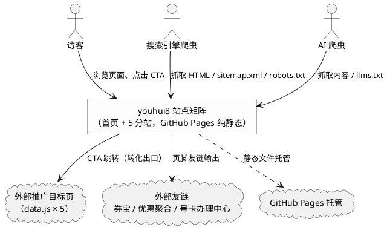
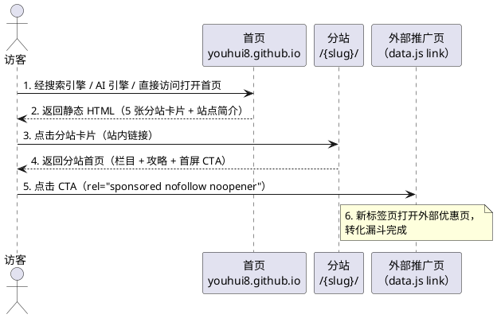

# 优惠集合站点矩阵（youhui-network）需求规格

| 项目 | 内容 |
|------|------|
| 特性名称 | youhui-network |
| 文档类型 | spec.md（需求规格，定义"做什么"） |
| 版本 / 日期 | v1.0 / 2026-10-20 |
| 状态 | 待评审 |
| 数据源基线 | data.js（5 条推广链接，其中 2 条含 deadline: 2026.12.31） |
| 线上根地址 | https://youhui8.github.io/ |
| 配套文档 | design.md（技术设计，"怎么做"，由后续阶段产出） |

> 本文档只定义"做什么"（What），不涉及"怎么做"（How）。框架选型、代码组织、实现算法由 design.md 承担；但 URL 结构、文件清单、页面数量等契约级约定按项目授权在本规格中固化。
>
> 全部验收标准采用 EARS 格式书写：触发关键词（When / While / If / Where）与固定短语（the system shall）保留英文，变量部分使用简体中文。

---

# 1. 背景与目标

## 1.1 项目背景

youhui8.github.io 是托管于 GitHub Pages 的纯静态用户站点（线上地址 https://youhui8.github.io/），当前仓库仅包含 README.md 与 data.js 两个文件。data.js 中维护 5 条外部推广链接（本地生活 / 外卖 / 电商优惠聚合入口），其中 2 条标注了有效期（deadline: 2026.12.31）。

用户需求（原始诉求归纳）：以 data.js 为数据基础，将本仓库建设为"首页链接集合站 + 5 个垂直分站"的站点矩阵；各站通过底部友情链接互相跳转，并交换 3 个外部友链（券宝、优惠聚合、号卡办理中心）；整体要求内容充实且各站不雷同、SEO 与 AI 引擎友好、favicon 在桌面浏览器 / iPhone / Android 全平台正常加载（PNG 回退）、跨设备完美适配；成品质量"不要像新手站长做的东西"。

## 1.2 核心目标与转化漏斗

核心目标：构建一个可持续承接搜索引擎与 AI 引擎流量、并将访客逐步导向外部推广链接的纯静态站点矩阵。

转化漏斗（三层路径）：

```
搜索引擎 / AI 引擎（搜索、引用、推荐）
        │
        ▼
【第 1 层】首页 /（全链接集合导航站）
        │  点击分站卡片（站内链接，静态可索引）
        ▼
【第 2 层】垂直分站 /{slug}/（内容站：栏目 + 原创攻略）
        │  点击分站内醒目 CTA（外链，rel="sponsored nofollow"）
        ▼
【第 3 层】外部推广目标页（data.js 中的 link 字段）
```

漏斗设计原则：

1. **首页做枢纽，不做跳板**：首页承担"全集合入口 + 站点矩阵中枢"职责，优先把流量分发给 5 个分站（内链优先），首页本身不直出外部推广短链作为主入口。
2. **分站做内容，做转化**：分站承接并沉淀主题内容（攻略 / 指南），建立搜索排名与访客信任，再由首屏 CTA 完成外链转化。
3. **页脚友链网络托底**：6 站互通互链 + 3 个外部友链，保证爬取深度、权重流动与访客跨站浏览体验。

## 1.3 核心职责

本站点矩阵负责聚合 data.js 中的外部推广链接，以"首页导航 + 5 个垂直内容分站"的形式向访客提供优惠信息导航服务，实现搜索引擎可发现、AI 引擎可引用、访客可转化的纯静态优惠导航网络。

## 1.4 核心输入

1. 访客的浏览器访问请求（桌面浏览器 / iPhone Safari / Android Chrome）。
2. 搜索引擎爬虫与 AI 爬虫的抓取请求（HTML、robots.txt、sitemap.xml、llms.txt、favicon）。
3. data.js 中的推广链接数据（name / link / description / deadline 字段）。
4. 站长的仓库维护操作（编辑 data.js 与页面文件）。

## 1.5 核心输出

1. 返回给访客的静态 HTML 页面（全站 ≥ 17 页，见 3.3）。
2. 供爬虫抓取的 robots.txt、sitemap.xml 与供 AI 引擎读取的 llms.txt。
3. 对外部推广链接的引导跳转（转化漏斗出口，新窗口打开）。
4. 页脚输出的 6 站互链与 3 个外部友链。

## 1.6 职责边界（不做什么）

1. 不做用户系统（注册 / 登录 / 收藏 / 评论 / 消息）。
2. 不做后端服务、数据库、API、服务端渲染。
3. 不做构建流水线依赖（不引入"必须执行 Node 构建才能得到页面"的机制）。
4. 不做站内搜索、实时倒计时组件、暗色模式。
5. 不做完整 PWA 离线能力（Service Worker）——仅提供 manifest 与图标等基础资产。
6. 不对外提供任何 API。
7. 不监控外部短链的有效性（外部目标页失效不在本站责任范围，本站仅按 deadline 做展示降级）。

---

# 2. 术语与角色

## 2.1 领域术语

**站点矩阵**
: 指由首页与 5 个垂直分站组成、共同部署在 youhui8.github.io 同一域名下的 6 个站点的集合。

**分站**
: 指围绕单一主题（如美团优惠、京东外卖、到家服务）建设的垂直内容站，拥有独立目录（slug）与独立的内容体系、栏目结构和视觉基调。

**转化漏斗**
: 指"搜索引擎 / AI 引擎 → 首页 → 分站 → 外部推广链接"的三层流量路径。

**CTA（Call To Action）**
: 指分站页面中引导访客点击外部推广链接的醒目行动入口（按钮或显著链接区块）。

**友情链接（友链）**
: 指页脚"友情链接"区块中输出的站点互链与外部互换链接。
: 备注：本规格中"互链"特指 6 站之间的链接；"外部友链"特指 3 个站外友链（券宝、优惠聚合、号卡办理中心）。

**推广链接**
: 指 data.js 中 link 字段记录的外部目标地址，是本站的核心转化目标，全站共 5 条。

**有效期（deadline）**
: 指 data.js 中 deadline 字段标注的推广活动截止日期（源数据格式为 YYYY.MM.DD，仅部分记录存在）。

**过期降级**
: 指当前日期超过 deadline 后，页面将"限时"类紧迫文案切换为中性文案、但保留 CTA 可用性的处理行为。

**AI 爬虫**
: 指为生成式 AI / AI 搜索产品抓取网页内容的爬虫（GPTBot、ClaudeBot、PerplexityBot、Google-Extended、Bytespider、CCBot 等）。

**llms.txt**
: 指部署在站点根目录、向大语言模型描述站点结构与内容的 Markdown 清单文件。

**data.js**
: 指仓库根目录的推广链接数据文件，是全部推广链接信息的唯一数据源（Single Source of Truth）。
: 备注：当前文件尾部存在残留闭合符号（语法不完整），实现阶段必须规范化；其逻辑数据契约见第 10 章。

## 2.2 核心角色

1. **访客**：通过桌面浏览器、iPhone Safari、Android Chrome 访问站点的普通用户；目标是浏览优惠信息并进入优惠入口；全程无需登录、不留存任何个人信息。
2. **搜索引擎爬虫**：如 Googlebot、Bingbot；抓取并索引站点页面，是自然搜索流量的来源。
3. **AI 爬虫**：如 GPTBot、ClaudeBot、PerplexityBot；抓取内容用于生成式引擎训练与引用（GEO），是 AI 可发现性的服务对象。
4. **站长（维护者）**：本仓库的维护人员；通过编辑 data.js 与静态页面文件完成日常更新（新增链接、新增攻略、同步 sitemap）。

## 2.3 外部系统

1. **GitHub Pages 托管**：提供纯静态文件分发（需 .nojekyll 保证原样分发），线上根地址 https://youhui8.github.io/。
2. **外部推广目标页**：data.js 中 5 条 link 指向的第三方优惠集合页，是转化漏斗的终点。
3. **外部友链站点**：券宝（https://jdjdndn.github.io/）、优惠聚合（https://wcbblll.cc）、号卡办理中心（https://dlhaoka.com）。

## 2.4 交互上下文



---

# 3. 站点矩阵与信息架构

## 3.1 站点矩阵总表

| # | 规范 URL | 站名（拟定） | 对应 data.js 记录 | 外部推广链接（CTA 目标） | 内容定位 | 有效期 |
|---|----------|--------------|-------------------|--------------------------|----------|--------|
| 0 | `https://youhui8.github.io/` | 优惠集合导航 | —（汇总全部 5 条） | —（首页不直出外链） | 全站入口枢纽：5 大分站卡片导航 + 站点矩阵说明 | — |
| 1 | `/bendi/` | 本地生活优惠集 | 第 1 条（本地生活集合页） | `https://kzurl18.cn/tHj1ww` | 美团外卖、团购、酒旅等综合本地生活优惠导航与场景攻略 | 无 |
| 2 | `/meituan/` | 美团优惠专区 | 第 2 条（美团本地生活集合页） | `https://kurl07.cn/te2qe9` | 美团系（外卖 / 团购 / 酒旅）优惠玩法教程与红包攻略 | 2026-12-31 |
| 3 | `/jingdong-waimai/` | 京东外卖红包站 | 第 3 条（京东外卖集合页） | `https://1.yoourl.net/link/10009836aafbeff4e2171002ArLVtpn4` | 京东外卖红包领取教程、点餐省钱技巧 | 2026-12-31 |
| 4 | `/daojia/` | 到家服务特惠 | 第 4 条（本地生活集合页 · fxzb 源） | `http://h.fxzb.vip/2vnMAd0ISWs` | 特惠洗车、京东家政等到家服务优惠与避坑指南 | 无 |
| 5 | `/gouwu/` | 网购外卖省钱站 | 第 5 条（本地生活+网购集合页） | `https://taoduoyu118.kzurl01.cn/?tm8b2RlD` | 外卖红包 + 淘宝 / 京东 / 拼多多网购优惠的全场景省钱清单 | 无 |

说明：

1. 站名为拟定值，Phase B / C 实现时可微调措辞，但必须保持 6 站站名两两不同，且每站与 data.js 记录的对应关系不变。
2. data.js 第 1 条与第 4 条的 name 同为"本地生活集合页"，但描述不同（第 1 条偏外卖 / 团购 / 酒旅综合，第 4 条偏洗车 / 家政 / 到家服务）；分站必须以描述差异区分定位，首页卡片必须呈现差异化的站名与描述，避免访客看到两个同名入口而混淆。

## 3.2 URL 与文件结构约定（契约级固化）

```
/                               首页（index.html）
/about/                         关于本站（首页站的说明页）
/bendi/index.html               分站首页
/bendi/{guide-slug}.html        分站攻略页 × ≥2
/meituan/index.html             同上结构
/jingdong-waimai/index.html     同上结构
/daojia/index.html              同上结构
/gouwu/index.html               同上结构
/data.js                        唯一推广数据源（语法合法）
/favicon.ico                    图标资产（完整清单见第 7 章）
/favicon-16x16.png
/favicon-32x32.png
/apple-touch-icon.png
/android-chrome-192x192.png
/android-chrome-512x512.png
/site.webmanifest
/og-home.png                    OG 分享图（1200×630，每站 1 张，共 ≥6 张）
/og-bendi.png
/og-meituan.png
/og-jingdong-waimai.png
/og-daojia.png
/og-gouwu.png
/robots.txt
/sitemap.xml
/llms.txt
/.nojekyll
```

结构规则：

1. 分站目录以**带尾斜杠 URL** 为规范地址（canonical 使用 `https://youhui8.github.io/{slug}/` 形式）。
2. 攻略页使用语义化英文 slug 命名（如 `/meituan/hongbao-guide.html`），禁止无意义命名（如 `a1.html`、`page2.html`）。
3. 全站静态资源（CSS / 图片 / 图标 / manifest）必须存放在本仓库内并通过相对路径或根路径引用，禁止依赖外部 CDN。
4. 每个分站目录内允许有独立的样式文件或共用全站样式，但页面文件必须直接可被 GitHub Pages 原样分发（无需构建产物目录）。

## 3.3 最小页面清单（数量基线）

| 站点 | 最少页面数 | 明细 |
|------|-----------|------|
| 首页站 | 2 | `/index.html`、`/about/index.html` |
| `/bendi/` | 3 | index + 攻略 ≥ 2 |
| `/meituan/` | 3 | index + 攻略 ≥ 2 |
| `/jingdong-waimai/` | 3 | index + 攻略 ≥ 2 |
| `/daojia/` | 3 | index + 攻略 ≥ 2 |
| `/gouwu/` | 3 | index + 攻略 ≥ 2 |
| **全站合计** | **≥ 17** | 全部纳入 sitemap.xml 与 llms.txt |

---

# 4. 功能需求

## 4.1 首页导航（REQ-NAV）

**REQ-NAV-001**（分站入口完整呈现）
When 访客打开首页 `https://youhui8.github.io/`，the system shall 展示与 data.js 5 条记录一一对应的 5 个分站入口卡片，每张卡片包含：分站站名、一句话定位描述（≥ 20 个中文字符）、指向对应分站规范 URL 的链接。

**REQ-NAV-002**（静态可索引）
While 搜索引擎爬虫或 AI 爬虫在未执行 JavaScript 的条件下抓取首页，the system shall 在初始 HTML 源码中完整提供全部 5 个分站入口链接、卡片文案与站点简介文案（核心内容不依赖运行时脚本渲染后才出现）。

**REQ-NAV-003**（语义化锚文本）
When 首页展示分站入口，the system shall 使用各分站站名作为链接锚文本（或以站名为主标题的可点击卡片），禁止仅使用"点击这里""进入""更多"等无语义文本作为链接。

**REQ-NAV-004**（内链优先，首页不做外链跳板）
首页的分站卡片必须链接到本站内部分站 URL；the system shall 禁止将外部推广短链作为首页卡片或首页任何主入口区块的链接目标（外链转化统一由分站 CTA 承担，见 REQ-CTA）。

**REQ-NAV-005**（首页有效期提示）
When data.js 中某条记录带有 deadline 字段，the system shall 在首页对应卡片上展示"有效期至 2026-12-31"形式的提示（展示与降级规则与 REQ-DL 系列一致）。

**REQ-NAV-006**（首页辅助导航）
首页必须提供到达"关于本站"页（`/about/`）的链接，以及包含 6 站互链与 3 个外部友链的页脚区块（规则见 REQ-LINK）。

## 4.2 分站 CTA 跳转（REQ-CTA）

**REQ-CTA-001**（首屏醒目 CTA）
When 访客打开任一分站首页，the system shall 在首屏（桌面与移动端的首个视口内、无需滚动）展示至少 1 个视觉醒目的 CTA，其链接目标为该分站对应的 data.js `link` 原始 URL。

**REQ-CTA-002**（攻略页内转化位）
When 访客浏览任一分站的攻略 / 指南页，the system shall 在正文中提供至少 1 个指向该分站外部推广链接的 CTA 或上下文引导链接。

**REQ-CTA-003**（新窗口安全跳转）
When 访客点击任一外部推广链接，the system shall 在新的浏览器标签页中打开目标页且不影响访客当前页面，并携带 `rel="noopener"` 防止窗口引用泄漏。

**REQ-CTA-004**（推广属性标注）
全站所有指向外部推广链接（data.js 的 link）的 `<a>` 元素必须标记 `rel="sponsored nofollow noopener"`，使推广性质对搜索引擎透明。

**REQ-CTA-005**（链接忠实性）
任一页面展示的外部推广 URL 必须与 data.js 中 link 字段逐字符一致；the system shall 禁止改写、追加参数或二次包装推广 URL。

**REQ-CTA-006**（CTA 预期管理）
每个分站的 CTA 区块必须附带至少 15 个中文字符的说明文案，说明点击后将进入外部优惠页面（与 REQ-COMP-001 披露声明配合）。

## 4.3 有效期展示与过期处理（REQ-DL）

**REQ-DL-001**（有效期内展示）
While 当前日期不晚于某推广链接的 deadline（2026-12-31），the system shall 在该链接对应的分站及首页卡片展示有效期提示，格式统一为"有效期至 2026-12-31"（YYYY-MM-DD），并可附加"限时"类标签。

**REQ-DL-002**（过期优雅降级）
If 当前日期已超过某推广链接的 deadline，the system shall 将该链接相关文案降级为中性表述（如"活动时间可能已结束，可点击查看最新情况"），并隐藏"限时""倒计时"等紧迫感元素；CTA 本身必须保留可点击（外部目标是否仍有效由目标方决定）。

**REQ-DL-003**（禁止失实紧迫文案）
If 当前日期已超过 deadline，the system shall 禁止继续展示"限时有效""即将截止"等与事实不符的紧迫性文案。

**REQ-DL-004**（无期限链接不虚构期限）
If 某推广链接在 data.js 中无 deadline 字段，the system shall 不为其展示任何有效期或限时元素（禁止虚构期限制造紧迫感）。

**REQ-DL-005**（过期判断自动生效）
When 系统日期跨越 deadline，the system shall 自动完成 REQ-DL-002 的降级切换（通过页面内轻量日期比较或等价机制），禁止依赖站长手工修改文案才能过期。

## 4.4 友情链接网络（REQ-LINK）

**REQ-LINK-001**（全站页脚友链区块）
全站 6 个站点（首页 + 5 分站）的每个页面必须在页脚包含"友情链接"区块。

**REQ-LINK-002**（站点矩阵互链）
When 任一页面渲染页脚，the system shall 输出指向其余 5 个站点（当前站以外的首页与分站）的互链，使用绝对 URL（`https://youhui8.github.io/...`）并以各站站名作为锚文本。

**REQ-LINK-003**（外部友链）
When 任一页面渲染页脚，the system shall 输出 3 个外部友链：券宝 → `https://jdjdndn.github.io/`、优惠聚合 → `https://wcbblll.cc`、号卡办理中心 → `https://dlhaoka.com`；锚文本固定为"券宝""优惠聚合""号卡办理中心"。

**REQ-LINK-004**（可爬取的普通链接）
互链与外部友链必须为可被爬虫跟随的普通 `<a href>` 链接；the system shall 禁止以 JS 跳转实现友链，且互链不得添加 nofollow（外部友链按常规友链对待，不标 sponsored）。

**REQ-LINK-005**（一键可达）
If 爬虫或访客位于全站任一页面，the system shall 保证仅通过该页页脚互链即可 1 次点击到达其余 5 个站点中的任意一个（任意页面到任一站点的链接距离 ≤ 1）。

**REQ-LINK-006**（无 JS 可见）
While 浏览器禁用 JavaScript，the system shall 保证页脚友链区块完整可见且可点击（静态输出）。

## 4.5 关键交互流程

转化漏斗主干时序：



## 4.6 异常场景

1. **data.js 运行时不可用**
   - 触发条件：页面引用的 data.js 请求失败或被拦截。
   - 系统行为：全部核心内容（导航、卡片、CTA、友链）为静态 HTML 直出，不依赖运行时读取 data.js 渲染。
   - 用户感知：无任何异常，页面功能完整。

2. **外部推广链接失效**
   - 触发条件：外部短链被目标平台下线、跳转失败或活动结束。
   - 系统行为：本站只负责展示与跳转，不做拦截与代理；带 deadline 的链接过期后按 REQ-DL-002 降级文案。
   - 用户感知：跳转后由目标方页面呈现实际状态。

3. **JavaScript 被禁用**
   - 触发条件：访客浏览器禁用脚本执行。
   - 系统行为：导航、CTA、友链、正文内容全部以静态 HTML 呈现；仅日期判断类增强（如动态倒计时文案）退化为静态文案。
   - 用户感知：浏览与跳转功能完整可用。

4. **窄屏 / 老旧设备访问**
   - 触发条件：320px 级窄屏或低性能设备访问。
   - 系统行为：布局按移动优先规则堆叠，资源保持轻量（见 REQ-NFR 系列）。
   - 用户感知：无横向滚动、无布局破碎。

---

# 5. 内容需求

## 5.1 页面数量与实质内容量（REQ-CONTENT）

**REQ-CONTENT-001**（页面数量基线）
每个分站必须至少包含 3 个页面（1 个分站首页 + ≥ 2 篇原创攻略 / 指南页）；首页站必须至少包含 2 个页面（index + about）。全站页面总数 ≥ 17，全部被 sitemap.xml 与 llms.txt 收录。

**REQ-CONTENT-002**（分站首页内容量）
每个分站首页的正文实质内容 ≥ 500 个中文字符（不含全局导航、页脚、面包屑等模板文字），且包含 ≥ 3 个内容区块（如栏目介绍、攻略列表、优惠入口说明）。

**REQ-CONTENT-003**（攻略页内容量）
每篇攻略 / 指南页的正文实质内容 ≥ 600 个中文字符，标题层级 ≥ 2 级（h2 / h3），且至少包含 1 个结构化列表或表格。

**REQ-CONTENT-004**（首页内容量）
首页 index.html 必须包含 ≥ 400 个中文字符的站点介绍文案（说明站点矩阵的用途与使用方式），以及满足 REQ-NAV-001 的 5 张分站卡片（每张卡片描述 ≥ 20 字）。

**REQ-CONTENT-005**（禁止占位内容）
全站禁止出现 Lorem ipsum、"待补充"、TODO、示例占位图、重复段落填充、凑字文本等任何占位性内容。

**REQ-CONTENT-006**（禁止关键词堆砌）
任何页面不得出现以 SEO 为目的的关键词机械重复；the system shall 保证全部文案以自然人类语言通顺可读。

**REQ-CONTENT-007**（原创与真实）
全部文案必须为原创简体中文内容；涉及优惠玩法、平台规则的表述必须真实合理，不虚构优惠力度、不编造平台活动。

**REQ-CONTENT-008**（聚合导航身份表述）
When 页面提及第三方平台（美团、京东、饿了么、淘宝、拼多多等），the system shall 使用与"信息聚合导航"身份一致的表述（如"美团外卖红包领取入口"），不得表述为或暗示为平台官方（详见 REQ-COMP-003）。

## 5.2 差异化矩阵（REQ-DIFF）

**REQ-DIFF-001**（站名与主题词唯一）
6 个站点的站名、首页 title 主题词、首页 h1 主张必须两两不同（验收方式：逐对比对，无重复）。

**REQ-DIFF-002**（独特栏目）
每个分站必须拥有 ≥ 2 个其他分站没有的独特内容栏目（H2 级栏目主题），栏目规划落在下表差异化矩阵范围内（措辞可微调，角度不可趋同）：

| 站点 | 内容角度 | 独特栏目方向（示例） | 视觉基调要求 | 攻略体裁 |
|------|----------|---------------------|--------------|----------|
| 首页 | 全站枢纽 | 分站导航、站点矩阵说明 | 中性、清爽、留白 | 导览说明 |
| `/bendi/` | 综合本地生活 | 外卖点餐场景、团购拼单、酒旅特惠 | 暖橙 / 暖黄色系 | 场景化攻略（如"周末聚餐怎么点划算"） |
| `/meituan/` | 美团系专题 | 红包领取教程、神券 / 会员玩法 | 黄绿色系（与暖橙明确区分） | 步骤教程型 |
| `/jingdong-waimai/` | 京东外卖专题 | 红包入口、首单优惠、跨平台点餐对比 | 红色系 | 对比 / 测评型 |
| `/daojia/` | 到家服务 | 洗车特惠、家政保洁、上门服务避坑 | 蓝色系（服务信任感） | 服务指南型 |
| `/gouwu/` | 网购 + 外卖全场景 | 电商省钱清单、大促节奏、返利省钱法 | 紫色 / 渐变系 | 清单导购型 |

**REQ-DIFF-003**（主色可区分）
6 个站点的主题色必须两两可区分（验收方式：取 6 站主色值两两比对，允许同色系但色相 / 明度有显著目测差异，并排打开 6 站首页 10 秒内可目测区分归属）。

**REQ-DIFF-004**（攻略选题不重复）
任意两个站点的攻略选题不得重复（验收方式：对比各站攻略标题清单无重复主题；同一话题若多站涉及，切入角度必须显著不同）。

**REQ-DIFF-005**（禁止跨站正文复制）
任何页面的正文段落不得与其他页面的正文段落逐段雷同；the system shall 允许共享的仅限全局组件文字（导航、页脚、CTA 模块、披露声明）。

**REQ-DIFF-006**（同源设计系统、异质呈现）
各站允许共享统一的设计系统基础（字体层级、间距规范），但必须通过主色、强调元素与栏目结构形成可感知的站间差异；the system shall 禁止 6 站使用完全相同的页面布局模板仅换文字。

---

# 6. 可发现性需求（SEO 与 AI 友好）

## 6.1 SEO（REQ-SEO）

**REQ-SEO-001**（唯一 title）
全站每个页面必须拥有唯一的 `<title>`，格式约定"{页面主题}｜{站名}"，长度 ≤ 30 个中文字符。

**REQ-SEO-002**（唯一 meta description）
全站每个页面必须拥有唯一的 meta description，长度 60 ～ 120 个中文字符，准确概括页面内容；the system shall 禁止全站或多页复用同一描述。

**REQ-SEO-003**（canonical）
每个页面必须声明 `<link rel="canonical">` 指向自身规范绝对 URL；分站目录页使用带尾斜杠形式（`https://youhui8.github.io/{slug}/`）。

**REQ-SEO-004**（语义化结构）
每个页面必须使用语义化 HTML5 结构（header / nav / main / article 或 section / footer），且每页有且仅有 1 个 h1。

**REQ-SEO-005**（Open Graph）
每个页面必须提供 Open Graph 基础标签：og:title、og:description、og:type、og:url；每站首页额外提供 og:image，指向真实存在的 1200×630 PNG；6 站首页的 og:image 必须两两不同；攻略页 og:image 可复用所在站图片。

**REQ-SEO-006**（JSON-LD 结构化数据）
每个页面必须至少包含 1 段类型正确且可解析的 JSON-LD，按页面类型选用：
1. 首页：WebSite；
2. 分站首页：CollectionPage（或 WebPage）+ ItemList（栏目 / 攻略列表）；
3. 攻略页：Article（含 headline、datePublished、author）；
4. 首页以外的页面：BreadcrumbList（与可见面包屑一致）；
5. 全站至少 2 个页面提供 FAQPage，且 FAQ 内容与页面可见内容一致。

**REQ-SEO-007**（sitemap.xml）
sitemap.xml 必须收录全站全部页面（≥ 17 个 URL），使用绝对 URL，包含 lastmod 字段，并随页面新增 / 修改同步更新。

**REQ-SEO-008**（robots.txt）
robots.txt 必须遵循以下结构（参考模板：E:\code\kuandai18.github.io\robots.txt）：
1. `User-agent: *` → `Allow: /`；
2. 显式允许 AI 爬虫：GPTBot、ClaudeBot、PerplexityBot、Google-Extended、Bytespider、CCBot，各自 `Allow: /`；
3. 末行声明 `Sitemap: https://youhui8.github.io/sitemap.xml`。

**REQ-SEO-009**（语言声明）
全站每个页面的 html 根元素必须声明 `lang="zh-CN"`。

**REQ-SEO-010**（内链深度）
全站内链结构必须满足：从首页 1 次点击可达任一分站首页；从任一页面 1 次点击可达其余 5 站（由 REQ-LINK-005 保证）；每篇攻略页可从所属分站首页 1 次点击可达。

**REQ-SEO-011**（面包屑）
分站首页与攻略页必须提供可见的面包屑导航（如"首页 › 京东外卖红包站 › 攻略标题"），且与该页 BreadcrumbList 结构化数据一致。

## 6.2 AI 友好（REQ-AI）

**REQ-AI-001**（llms.txt）
站点根目录必须提供 llms.txt（Markdown 格式），内容包括：站点矩阵总览（6 站名称 / URL / 定位一句话）、各站主要页面清单（含攻略页）、内容说明；the system shall 保证 llms.txt 描述与实际站点结构一致。

**REQ-AI-002**（AI 爬虫显式允许）
robots.txt 必须显式允许 REQ-SEO-008 列出的全部 AI 爬虫（验收时与 SEO 项合并核验）。

**REQ-AI-003**（无 JS 可读）
While AI 爬虫在未执行 JavaScript 的条件下抓取任一页面，the system shall 提供结构完整、标题层级正确的全文内容（无依赖脚本渲染才出现的信息）。

**REQ-AI-004**（机器可解析结构）
页面正文必须使用不跳级的标题层级（h1 → h2 → h3）、语义化列表与表格组织信息，便于机器解析与引用。

---

# 7. favicon 与 PWA 基础资产（REQ-FAV）

## 7.1 资产文件清单（契约级固化）

**REQ-FAV-001**（完整图标资产）
仓库根目录必须提供以下图标与 manifest 资产文件，全部真实存在且可公开访问：

| 文件 | 规格 | 用途 |
|------|------|------|
| `/favicon.ico` | 多尺寸 ICO（16×16、32×32、48×48） | 桌面浏览器标签页默认回退 |
| `/favicon-16x16.png` | 16×16 PNG | 桌面浏览器高 DPI 回退 |
| `/favicon-32x32.png` | 32×32 PNG | 桌面浏览器标准标签页 |
| `/apple-touch-icon.png` | 180×180 PNG | iPhone / iPad 添加到主屏幕 |
| `/android-chrome-192x192.png` | 192×192 PNG | Android Chrome 图标 |
| `/android-chrome-512x512.png` | 512×512 PNG | Android Chrome 高清图标 / 启动画面 |
| `/site.webmanifest` | Web App Manifest | Android 安装信息与图标声明 |

**REQ-FAV-002**（webmanifest 内容约束）
`site.webmanifest` 必须包含 name、short_name、icons（192 与 512 两档 PNG，type 正确）与 theme_color；全站页面统一引用根路径 `/site.webmanifest`。

**REQ-FAV-003**（head 引用链）
全站每个页面的 `<head>` 必须声明图标引用链，至少包含：
1. `<link rel="icon" href="/favicon.ico" sizes="any">`
2. `<link rel="icon" type="image/png" sizes="32x32" href="/favicon-32x32.png">`
3. `<link rel="icon" type="image/png" sizes="16x16" href="/favicon-16x16.png">`
4. `<link rel="apple-touch-icon" href="/apple-touch-icon.png">`
5. `<link rel="manifest" href="/site.webmanifest">`

（具体写法可按平台惯例微调，但必须保证 REQ-FAV-004 的回退链路成立。）

**REQ-FAV-004**（全平台加载与 PNG 回退）
图标体系必须满足以下平台行为：
1. 桌面浏览器（Chrome / Edge / Firefox / Safari）：favicon.ico 与 PNG 均可正常加载，无 404；
2. iPhone（Safari"添加到主屏幕"）：apple-touch-icon.png（180×180）正常显示；
3. Android（Chrome 安装 / 书签）：经 site.webmanifest 的 192 / 512 图标正常显示；
4. If 浏览器不支持 webmanifest 或某个 PNG 规格，the system shall 经 link 标签链路回退到下一级 PNG / ICO 正常呈现，不出现 404。

**REQ-FAV-005**（统一品牌与原创图形）
全站 6 站统一使用同一套 favicon（品牌一致性）；图标必须为原创设计图形，禁止空白图、占位图或盗用第三方品牌 Logo。

**REQ-FAV-006**（OG 分享图资产）
根目录必须提供 ≥ 6 张 1200×630 PNG 分享图，每站 1 张、两两不同，与 REQ-DIFF-003 视觉基调一致，命名约定：`/og-home.png`（首页）、`/og-{slug}.png`（各分站）；og:image 引用（REQ-SEO-005）必须指向真实存在的文件。

---

# 8. 响应式与跨设备兼容（REQ-RWD）

**REQ-RWD-001**（移动优先全范围适配）
全站页面必须采用移动优先的响应式布局，在 320px（iPhone SE 级窄屏）至 1920px+（桌面宽屏）范围内正常显示：无横向滚动条、无元素溢出遮挡、无文字截断错位。

**REQ-RWD-002**（移动端触控）
While 访客使用 iPhone（Safari）或 Android（Chrome）访问，the system shall 保证：CTA 按钮与主要可点元素的触控区域 ≥ 44×44px；分站卡片、页脚友链、导航在窄屏下正确堆叠且间距可读。

**REQ-RWD-003**（桌面端排版）
While 访客使用桌面浏览器（Chrome / Edge / Firefox / Safari 最新两个大版本）访问，the system shall 保证正文阅读宽度受限（禁止全屏拉伸长行文本），分站卡片呈多列布局且对齐正常。

**REQ-RWD-004**（图片适配）
If 页面包含图片，the system shall 提供与展示尺寸匹配的合理图片文件（单张 ≤ 300KB），不因超大原图拖慢移动端加载。

**REQ-RWD-005**（旋转与视口变化）
When 移动设备发生横竖屏切换或窗口尺寸变化，the system shall 保持布局正常（无错位、无内容丢失）。

---

# 9. 非功能需求

## 9.1 性能（REQ-NFR）

**REQ-NFR-001**（零重依赖）
页面不得引入重型前端框架（React / Vue / jQuery 等运行时库）与外部 CSS / JS / 字体 CDN 依赖；样式与脚本以仓库内静态文件或内联方式提供。

**REQ-NFR-002**（资源体量上限）
单页 HTML 文档 ≤ 100KB；全站 CSS 合计 ≤ 50KB / 页；JS（如存在）合计 ≤ 50KB / 页且不阻塞首屏渲染。

**REQ-NFR-003**（Lighthouse 基线）
在 Lighthouse 移动端模拟下抽检首页与各分站 index：Performance ≥ 90、Accessibility ≥ 90、Best Practices ≥ 90、SEO ≥ 95。

**REQ-NFR-004**（核心体验指标）
核心页面（首页 + 各分站 index）Largest Contentful Paint ≤ 2.5s（模拟移动网络），Cumulative Layout Shift ≤ 0.1。

## 9.2 可靠性（REQ-NFR）

**REQ-NFR-005**（零死链）
全站不得存在死链：所有站内链接（含图标、manifest、og:image 引用）必须指向真实存在的文件并正常返回；the system shall 禁止在导航中出现 `href="#"`、`javascript:void(0)` 形式的伪链接。

**REQ-NFR-006**（.nojekyll）
仓库根目录必须包含 `.nojekyll` 空文件，保证 GitHub Pages 按纯静态原样分发（避免 Jekyll 对下划线开头文件与目录的忽略问题）。

**REQ-NFR-007**（浏览器兼容）
全站页面在主流浏览器最新版与前一版本中正常运行：无 JS 报错、控制台无 404 / 403 资源错误。

## 9.3 可维护性（REQ-NFR）

**REQ-NFR-008**（data.js 唯一数据源）
data.js 必须作为全部推广链接的唯一数据源：5 条记录的 name / link / description / deadline 仅在 data.js 中定义一次；全站页面展示的站名、描述、推广 URL、有效期必须与 data.js 逐字一致（验收抽检逐字比对）。

**REQ-NFR-009**（变更同步流程）
If 站长修改 data.js 中某条推广链接（改名 / 换 URL / 调整 deadline），the system shall 提供文档化的同步维护流程（README 维护说明），明确列出"修改数据后需要同步更新哪些页面与文件（分站卡片、CTA、sitemap、llms.txt 等）"，保证变更可被无遗漏地落实。

**REQ-NFR-010**（data.js 语法合法）
data.js 必须是语法合法、可直接被浏览器执行的 JavaScript 文件（当前版本尾部存在残留闭合符号，实现阶段必须修复）。

**REQ-NFR-011**（维护文档）
仓库 README.md 必须包含维护说明：站点矩阵结构图、如何新增 / 修改推广链接（含对应分站的扩展流程）、如何新增攻略页并同步更新 sitemap.xml 与 llms.txt。

## 9.4 合规（REQ-COMP）

**REQ-COMP-001**（推广性质披露）
每个站点的页脚必须包含推广性质披露声明（语义示例："本站为优惠信息聚合导航，部分链接为推广链接，点击后将跳转第三方页面"），文字清晰可读、不得隐藏或弱化到不可见。

**REQ-COMP-002**（品牌免责声明）
每个站点必须包含品牌免责声明（语义示例："本站与美团、京东、饿了么、淘宝、拼多多等品牌无关联，相关商标及名称归各自权利人所有"），位置在页脚或关于页。

**REQ-COMP-003**（禁止冒充官方）
全站禁止嵌入第三方品牌 Logo / 商标图片；提及平台时仅以文字表述，整体视觉与文案不得暗示官方身份。

**REQ-COMP-004**（技术性披露落实）
外部推广链接的 rel 标注（REQ-CTA-004）与页脚披露声明（REQ-COMP-001）必须同时落实，构成对访客与搜索引擎的双重推广透明度。

---

# 10. 数据约束

## 10.1 推广链接记录（data.js 逻辑契约）

每条推广链接记录必须满足以下逻辑约束（与存储实现无关）：

1. **name**：必填，字符串，非空；同一文件内允许重名（现实中第 1、4 条同名），但分站站名必须差异化消歧（见 3.1 说明 2）。
2. **link**：必填，字符串，合法的 http / https URL；全文件内唯一（禁止两条记录指向同一 link）。
3. **description**：必填，字符串，≥ 10 个中文字符；描述方向必须与对应分站的内容定位一致。
4. **deadline**：可选，字符串，源格式 `YYYY.MM.DD`（当前数据为 `'2026.12.31'`）；页面展示时必须规范化为 `YYYY-MM-DD`。

## 10.2 站点与数据映射约束

1. 每个分站与 data.js 记录必须保持 1:1 固定映射（见 3.1 总表）；禁止一个分站同时转化两条推广链接，也禁止一条推广链接没有分站承接。
2. If 未来新增第 6 条推广链接，the system shall 按既有模式扩展：新增分站目录（index + ≥ 2 攻略）、首页新增卡片、全部站点页脚互链更新、sitemap.xml 与 llms.txt 同步更新；扩展流程必须写入 README 维护说明。
3. If data.js 中某条记录被删除，the system shall 按维护流程下线对应分站入口并同步清理 sitemap / llms.txt / 互链，避免产生死链。

---

# 11. 验收标准（Phase G 逐条核验清单）

> 本清单与正文需求编号一一对应，供验证阶段逐条勾选。全部条目通过方可视为规格达成。

## A. 站点矩阵与导航

- [ ] 6 个站点规范 URL（`/`、`/bendi/`、`/meituan/`、`/jingdong-waimai/`、`/daojia/`、`/gouwu/`）全部可访问（REQ-NAV / 3.1）
- [ ] 首页初始 HTML 源码（禁 JS 查看源码）含 5 张分站卡片与全部内链（REQ-NAV-001 / 002）
- [ ] 首页卡片锚文本为分站站名，描述 ≥ 20 字（REQ-NAV-003 / REQ-CONTENT-004）
- [ ] 首页无外部推广短链作为主入口（REQ-NAV-004）
- [ ] 全站页面总数 ≥ 17：每分站 ≥ 3 页、首页站 ≥ 2 页（REQ-CONTENT-001）

## B. CTA 与有效期

- [ ] 每个分站首屏（无滚动）有醒目 CTA，目标 URL 与 data.js link 逐字符一致（REQ-CTA-001 / 005）
- [ ] 全部外链带 `rel="sponsored nofollow noopener"` 且新标签打开（REQ-CTA-003 / 004）
- [ ] 每篇攻略页正文含至少 1 个 CTA 或引导链接（REQ-CTA-002）
- [ ] CTA 区块附带 ≥ 15 字外部跳转说明（REQ-CTA-006）
- [ ] `/meituan/` 与 `/jingdong-waimai/` 展示"有效期至 2026-12-31"（REQ-DL-001）
- [ ] 无 deadline 的 3 条链接无任何限期元素（REQ-DL-004）
- [ ] 将系统时间调至 2027-01-01：限期文案自动降级为中性表述、CTA 保留可点、无失实紧迫文案（REQ-DL-002 / 003 / 005）

## C. 友情链接网络

- [ ] 6 站每页页脚含"友情链接"区块（REQ-LINK-001）
- [ ] 每页页脚含指向其余 5 站的互链：绝对 URL + 站名锚文本（REQ-LINK-002）
- [ ] 每页页脚含 3 个外部友链：券宝 / 优惠聚合 / 号卡办理中心，锚文本正确（REQ-LINK-003）
- [ ] 互链为普通 `<a href>`、非 JS 跳转、无 nofollow（REQ-LINK-004）
- [ ] 从任一页面经页脚 1 次点击可达其余 5 站（REQ-LINK-005）
- [ ] 禁 JS 环境下页脚友链完整可见（REQ-LINK-006）

## D. 内容与差异化

- [ ] 分站首页正文 ≥ 500 字 + ≥ 3 内容区块（REQ-CONTENT-002）
- [ ] 攻略页正文 ≥ 600 字 + ≥ 2 级标题 + ≥ 1 列表或表格（REQ-CONTENT-003）
- [ ] 首页 ≥ 400 字站点介绍（REQ-CONTENT-004）
- [ ] 全站无 Lorem ipsum / TODO / 占位 / 凑字内容，无关键词堆砌（REQ-CONTENT-005 / 006）
- [ ] 文案原创、真实，平台表述符合聚合导航身份（REQ-CONTENT-007 / 008）
- [ ] 6 站站名 / title 主题词 / h1 两两不同（REQ-DIFF-001）
- [ ] 每站 ≥ 2 个独特栏目，符合差异化矩阵（REQ-DIFF-002）
- [ ] 6 站主色两两可区分，并排打开 10 秒内可目测区分（REQ-DIFF-003 / 006）
- [ ] 各站攻略选题无重复主题（REQ-DIFF-004）
- [ ] 无跨站正文段落复制（REQ-DIFF-005）

## E. SEO

- [ ] 每页唯一 title（≤ 30 字）与唯一 meta description（60～120 字）（REQ-SEO-001 / 002）
- [ ] 每页 canonical 指向自身规范绝对 URL，分站目录带尾斜杠（REQ-SEO-003）
- [ ] 语义化 HTML5 结构 + 每页唯一 h1（REQ-SEO-004）
- [ ] OG 四项基础标签齐全；6 站 index 的 og:image 两两不同且文件存在（REQ-SEO-005）
- [ ] JSON-LD 按页型正确：首页 WebSite、分站 index CollectionPage+ItemList、攻略 Article、面包屑 BreadcrumbList、全站 ≥ 2 个 FAQPage（REQ-SEO-006）
- [ ] sitemap.xml 收录全部 ≥ 17 页、绝对 URL、含 lastmod（REQ-SEO-007）
- [ ] robots.txt 符合模板：`User-agent: * Allow: /` + 6 个 AI 爬虫显式允许 + Sitemap 行（REQ-SEO-008）
- [ ] 每页 `lang="zh-CN"`（REQ-SEO-009）
- [ ] 内链深度满足：首页 1 跳达各分站、攻略页从分站 index 1 跳可达（REQ-SEO-010）
- [ ] 面包屑可见且与 BreadcrumbList 一致（REQ-SEO-011）

## F. AI 友好

- [ ] `/llms.txt` 可访问，内容与站点结构一致（REQ-AI-001）
- [ ] robots.txt AI 爬虫显式允许（REQ-AI-002，与 E 项合并核验）
- [ ] 禁 JS 抓取任一页面，正文内容完整可读（REQ-AI-003）
- [ ] 标题层级无跳级，列表 / 表格语义化（REQ-AI-004）

## G. favicon 与资产

- [ ] 7 项图标 / manifest 文件全部存在（REQ-FAV-001）
- [ ] webmanifest 含 name / short_name / icons(192+512) / theme_color（REQ-FAV-002）
- [ ] 每页 head 图标引用链完整（REQ-FAV-003）
- [ ] 桌面浏览器 Network 面板图标请求无 404；iOS 主屏幕图标正常；Android 经 manifest 图标正常（REQ-FAV-004）
- [ ] favicon 为原创统一设计，无第三方 Logo（REQ-FAV-005）
- [ ] ≥ 6 张 1200×630 og-*.png，两两不同、命名符合约定（REQ-FAV-006）

## H. 响应式

- [ ] 320px ～ 1920px+ 无横向滚动 / 布局破碎（REQ-RWD-001）
- [ ] iOS Safari 与 Android Chrome 下触控目标 ≥ 44px、窄屏堆叠正常（REQ-RWD-002）
- [ ] 桌面端正文阅读宽度受限、卡片多列对齐（REQ-RWD-003）
- [ ] 单张图片 ≤ 300KB（REQ-RWD-004）
- [ ] 横竖屏切换布局正常（REQ-RWD-005）

## I. 非功能

- [ ] 无外部框架 / CDN 依赖（REQ-NFR-001）
- [ ] 单页 HTML ≤ 100KB、CSS ≤ 50KB、JS ≤ 50KB 且非阻塞（REQ-NFR-002）
- [ ] Lighthouse 移动端抽检：P ≥ 90 / A11y ≥ 90 / BP ≥ 90 / SEO ≥ 95（REQ-NFR-003）
- [ ] LCP ≤ 2.5s、CLS ≤ 0.1（REQ-NFR-004）
- [ ] 全站零死链（含图标 / manifest / og:image 引用）（REQ-NFR-005）
- [ ] `.nojekyll` 存在于仓库根目录（REQ-NFR-006）
- [ ] 主流浏览器无控制台报错（REQ-NFR-007）
- [ ] 页面展示的站名 / 描述 / URL / 有效期与 data.js 逐字一致（抽检 5 条）（REQ-NFR-008）
- [ ] data.js 语法合法可执行（REQ-NFR-010）
- [ ] README 含维护说明：结构、改链接流程、加攻略流程（REQ-NFR-009 / 011）

## J. 合规

- [ ] 每站页脚含推广性质披露声明（REQ-COMP-001）
- [ ] 每站含品牌免责声明（页脚或关于页）（REQ-COMP-002）
- [ ] 全站无第三方品牌 Logo 图片，无冒充官方表述（REQ-COMP-003）

---

# 12. 超出范围（Out of Scope）

以下事项明确不在本特性范围内，任何阶段不得擅自引入：

1. 用户系统：注册、登录、收藏、评论、消息、个人中心。
2. 后端能力：任何服务端逻辑、数据库、对外 API、服务端渲染。
3. 构建流水线依赖：不引入"必须执行构建才能产出页面"的机制（允许但不要求轻量本地脚本辅助生成静态文件）。
4. 完整 PWA：Service Worker、离线缓存、消息推送（本特性仅覆盖 manifest + 图标基础资产）。
5. 站内搜索功能。
6. 暗色模式 / 主题切换。
7. 访问统计与埋点（GA、百度统计等）。
8. 多语言版本（仅简体中文）。
9. 外部短链有效性的自动监控与自动下线。
10. 首页直出外部推广链接的快捷跳转入口（首页只做分站分发，见 REQ-NAV-004）。
11. 邮件订阅、通知推送、社交分享组件（仅保留浏览器原生能力）。
12. 付费投放、外链购买等站外运营动作。

---

## 附：需求条目索引统计

| 需求区域 | 编号区间 | 条数 |
|----------|----------|------|
| 首页导航 | REQ-NAV-001 ～ 006 | 6 |
| 分站 CTA | REQ-CTA-001 ～ 006 | 6 |
| 有效期处理 | REQ-DL-001 ～ 005 | 5 |
| 友情链接网络 | REQ-LINK-001 ～ 006 | 6 |
| 内容要求 | REQ-CONTENT-001 ～ 008 | 8 |
| 差异化矩阵 | REQ-DIFF-001 ～ 006 | 6 |
| SEO | REQ-SEO-001 ～ 011 | 11 |
| AI 友好 | REQ-AI-001 ～ 004 | 4 |
| favicon 与资产 | REQ-FAV-001 ～ 006 | 6 |
| 响应式 | REQ-RWD-001 ～ 005 | 5 |
| 性能与可靠性 | REQ-NFR-001 ～ 011 | 11 |
| 合规 | REQ-COMP-001 ～ 004 | 4 |
| **合计** | | **78** |

